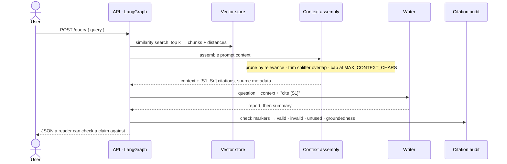

# RAG Report Generator

Point it at a folder of company documents, ask a question, and get a written
report back in which every line carries the marker of the passage it came from,
plus a check of whether those markers were real. LangGraph runs the pipeline,
ChromaDB holds the vectors, and a CLI and a FastAPI service expose it.

It needs **no API key**. Without one it embeds with a local sentence-transformer
and writes with an extractive writer that only quotes its sources, so the whole
pipeline (ingestion, retrieval, citations, the audit, the evaluation harness)
runs offline and reproduces from a clone. Set `OPENAI_API_KEY` and the same graph
writes with an OpenAI chat model instead, with cost tracked per call.

## Run it

```bash
docker compose up --build        # API and Swagger UI on http://localhost:8350/docs
```

The container indexes the three sample documents in `data/raw_data/` (a
fictional company, Northwind Analytics) on first start, so there is something to
ask straight away. The image is about 2.7 GB: CPU-only PyTorch plus the embedding
model, baked in so the stack runs with no internet once built.

```bash
curl -s -X POST http://localhost:8350/query \
  -H 'Content-Type: application/json' \
  -d '{"query": "What do customers complain about most?"}'
```

Without Docker, on Python 3.12 (`.python-version`):

```bash
python -m venv .venv && source .venv/bin/activate
pip install -r requirements.txt
python scripts/ingest_sample_data.py      # index data/raw_data/
python main.py --query "How much did revenue grow and which segment drove it?"
make serve                                # the API on :8350
```

`.env.example` documents every setting, and every one has a working default, so
copying it to `.env` is only needed to change something.
[`QUICKSTART.md`](QUICKSTART.md) has more commands and troubleshooting.

## A report, and the receipts

From the CLI, trimmed; the full transcript is in
[`docs/captured-output.md`](docs/captured-output.md):

```console
$ LOG_LEVEL=WARNING python main.py --query "What do customers complain about most?"
- ## What customers complained about Reporting flexibility remains the largest source of dissatisfaction, named in 44 percent of negative responses. [S1]
- Export limits were the second complaint, at 27 percent. [S1]
[S1] customer_satisfaction_q4.md  (distance 0.896)
[S2] customer_satisfaction_q4.md  (distance 1.207)
Groundedness: 1.00  (1.00 = every claim word is in a source)
Cited: S1, S2
```

Retrieval returned five chunks and the report cites two. The other three sat
more than 35% farther from the query than the best hit
(`CONTEXT_RELEVANCE_MARGIN`), so they never reached the prompt.

The audit exists for the failure that looks like success: a marker pointing at a
source that was never supplied. Swap in a writer that cites `[S7]` when only `S1`
and `S2` were supplied, and the audit names it:

```console
report:       Reporting flexibility is the top complaint [S1], and the Antarctic division tripled its titanium output [S7].
supplied:     ['S1', 'S2']
INVENTED:     ['S7']
groundedness: 0.3
not in any source: ['antarctic', 'division', 'its', 'output', 'titanium', 'top', 'tripled']
```

The graph logs `invented_citations` at ERROR, and `scripts/run_evaluation.py`
fails the run.

## The API

| Method | Path | What it does |
|---|---|---|
| `POST` | `/query` | Run the graph; returns the report, summary, citations and audit |
| `POST` | `/ingest/text` | Index a string under a source name |
| `POST` | `/ingest/file` | Index an uploaded `.pdf`, `.docx`, `.txt` or `.md` |
| `GET` | `/stats` | Collection name and chunk count |
| `GET` | `/costs` | Tokens and USD for this process, per model |
| `DELETE` | `/clear` | Drop the collection |
| `GET` | `/health` | Liveness plus the indexed chunk count (the container healthcheck) |

These responses were captured from the Compose stack with no API key set.
A query returns the provenance as data, not just as text:

```jsonc
// POST /query  {"query": "What do customers complain about most?"}   → 200
{
  "query": "What do customers complain about most?",
  "report": "## What do customers complain about most\n\nThe following passages were retrieved ...",
  "summary": "## What customers complained about Reporting flexibility remains the largest ...",
  "sources": ["customer_satisfaction_q4.md", "customer_satisfaction_q4.md"],
  "citations": [
    {
      "id": "S1",
      "source": "customer_satisfaction_q4.md",
      "score": 0.8960952758789062,
      "excerpt": "## What customers complained about\n\nReporting flexibility remains the largest source of dissatisfaction, named in 44\npercent of negative responses. ..."
    },
    { "id": "S2", "source": "customer_satisfaction_q4.md", "score": 1.2067742347717285, "excerpt": "..." }
  ],
  "citation_audit": { "valid": ["S1", "S2"], "invalid": [], "unused": [], "groundedness": 1.0, "ungrounded_sample": [] },
  "groundedness": 1.0,
  "num_tokens_used": 1099,
  "total_cost_usd": 0.0,
  "saved_file": null
}
```

(`report` and the excerpts are shortened here.) An uploaded Word file is cited
by the name it was uploaded under:

```bash
curl -s -F 'file=@board_pack_q1.docx' http://localhost:8350/ingest/file
```

```jsonc
// → 200
{ "message": "File 'board_pack_q1.docx' ingested successfully", "chunks_added": 1,
  "collection_name": "company_data", "total_documents": 7 }

// POST /query  {"query": "Why did the board freeze hiring in Vancouver?"}   → 200, 20 ms
"citations": [{ "id": "S1", "source": "board_pack_q1.docx", "score": 0.7054682374000549,
  "excerpt": "Board pack - Q1 outlook\n\nThe board approved a hiring freeze in the Vancouver office until the Q1 churn review is complete, ...\n\nQ1 hiring budget | frozen\n\nChurn review owner | Head of Customer Success" }]
```

Table rows come through as `cell | cell`. A `format` other than `text` or
`markdown` is rejected with a 422 rather than silently writing plain text. The
handlers are plain `def`, so the blocking work (embedding, Chroma, the model)
runs in FastAPI's threadpool: `/health` answered in 12 ms while a cold `/query`
was spending 3.6 s loading the embedding model.

## What happens when you ask a question



The four nodes (`src/agent/nodes.py`) each return **only the keys they changed**.
That matters because `retrieved_documents` has an accumulating reducer: a node
echoing the whole state back re-appends the documents it was handed, and four
nodes doing that turned `k` chunks into `8k`. Tests pin the key set each node
may return.

The arithmetic lives outside the graph. `context.py`, `citations.py` and
`evaluation/grounding.py` are pure functions over the standard library, so most
of the suite runs with no store and no model.

## Where the money goes

The bottleneck is the prompt, not CPU: every character assembled into context is
billed as an input token on every query. Assembly prunes chunks far from the best
hit, trims the overlap the splitter adds between adjacent chunks (5.6% duplicated
text at `CHUNK_OVERLAP=200`), then caps at `MAX_CONTEXT_CHARS`. Over the six
evaluation questions with the real local embedder, the mean report prompt goes
**921 → 588 tokens (−36.1%)** and the cost per report, priced as
`gpt-4-turbo-preview`, **$0.0982 → $0.0949 (−3.4%)**.

The cost saving is small for a reason. A report's 2,000 output tokens bill at 3×
the input rate, and none of this touches them. The input side is what grows with
the corpus, so that is where it shows. On a synthetic 1,200-chunk corpus:

| `k` | naive prompt | bounded prompt | $ naive | $ bounded | saving |
|---:|---:|---:|---:|---:|---:|
| 5 | 1,003 | 1,003 | 0.0990 | 0.0990 | 0.0% |
| 20 | 3,529 | 2,841 | 0.1243 | 0.1174 | 5.5% |
| 40 | 6,901 | 2,861 | 0.1580 | 0.1176 | 25.6% |
| 80 | 13,594 | 2,861 | 0.2249 | **0.1176** | **47.7%** |

Naive grows linearly with `k`; bounded plateaus. `python scripts/benchmark.py`
reproduces both tables, plus chunking, cache and latency measurements.

A content-addressed SQLite cache sits in front of every embedder, so warm
re-ingestion makes zero embedding calls. It is keyed on the model name *and* the
text, because one backend's vectors served to another retrieve the wrong chunks
without raising.

## Scoring retrieval without an LLM judge

`scripts/run_evaluation.py` scores six questions a human can check against the
three sample documents:

```
backend=local pass=6/6 recall=1.00 precision=0.40 faithfulness=0.98 p95=7157ms
  ✓ revenue-growth     recall=1.00 precision=0.40 faith=0.94 7157ms
  ✓ complaints         recall=1.00 precision=0.40 faith=0.99 3ms
  citation groundedness: mean 1.00
```

Precision of 0.40 is arithmetic, not a failure: six chunks in the corpus and
`TOP_K_RESULTS=5` means at most two of the five returned can come from the one
expected document. The p95 is the first query loading the embedding model; the
rest take milliseconds. Every metric is deterministic, so no model grades
another model's output: groundedness is lexical overlap with the text the report
was given, with the query excluded. The run exits non-zero below 0.80 mean recall
or 0.50 mean faithfulness, or on any invented citation.

## Swapping a backend

The chat model, the embedder and the vector store each go through one registry,
`src/providers/registry.py`, selected by `LLM_PROVIDER`, `EMBEDDING_PROVIDER`
and `VECTOR_BACKEND`:

```python
from src.providers import register_llm

def make_ollama(settings):
    from langchain_ollama import ChatOllama   # imported lazily
    return ChatOllama(model="llama3")

register_llm("ollama", make_ollama)          # then LLM_PROVIDER=ollama
```

Factories import inside their body, so registering a provider never makes an
OpenAI-only process import torch. An unregistered name raises immediately and
lists the alternatives rather than falling back to something that bills
someone. Two built-ins exist for measurement rather than serving: `hashing`
embeddings and the `memory` store, which let the benchmark run with no model
weights at all.

Switching embedders changes the vector width (384 for MiniLM, 3072 for
`text-embedding-3-large`). That needs `python main.py --clear` and a re-ingest;
the mismatch is logged as `embedding_dimension_mismatch` at startup.

## Development

```bash
python -m pytest -q                              # 296 tests
ruff check src/ tests/ scripts/ main.py
black --check src/ tests/ scripts/ main.py
```

Or inside the image, with nothing installed locally:

```bash
docker compose run --rm --no-deps api python -m pytest -q
```

No test can reach the network. Every OpenAI chat, embedding and HTTP call is
faked, and `tests/conftest.py` patches `socket.connect` and `connect_ex` to
refuse anything but loopback. `tests/test_network_guard.py` proves it by
attempting outbound connections (a raw socket, `connect_ex`,
`create_connection`, an HTTPS `httpx.get`, a hostname that resolves off-box) and
asserting each is refused, while the FastAPI `TestClient` still works. The guard
does not cover UDP, raw sockets or subprocesses.

Logs go to stdout and to `logs/app.log`, which rotates at
`LOG_ROTATION_SIZE_MB`. Set `ENVIRONMENT=production` to write both as JSON
lines. Per-call costs are appended to `logs/cost_tracking.json`.

## Known limits

- **Offline reports are extractive.** They quote and cite rather than
  synthesise. Groundedness is lexical, so it cannot tell a paraphrase from an
  invention, and the audit checks form, not truth: that a marker was supplied
  and the vocabulary came from the cited text, not that the text supports the
  claim.
- **No re-ranking.** Retrieval is plain top-`k` cosine plus a relative distance
  threshold with one global knob. Pruning declines to act against a backend that
  reports similarity rather than distance, since the wrong polarity would drop
  the best hits.
- **One collection, no tenancy, no auth.** CORS allows any origin, and
  ingestion runs inside the request.
- **The OpenAI defaults date from 2024.** `gpt-4-turbo-preview` and its price
  table in `src/observability/cost_tracker.py` were kept as they were. Pick a
  current model with `OPENAI_MODEL` and add its price to that table; a model
  missing from it is costed at $0 with an `unknown_model_pricing` warning.
- **The sample corpus is tiny**: three Markdown documents, six chunks. That is
  enough to check by hand and too small for the scaling work to show, which is
  why the benchmark adds a synthetic corpus.

## License

MIT, see [`LICENSE`](LICENSE).
