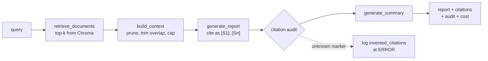
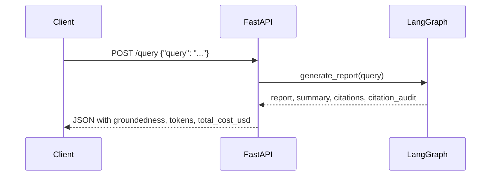

# RAG Report Generator

Point it at a folder of documents, ask a question, and get a written report where every line
carries a marker for the chunk it came from, plus an audit that says whether those markers are real.
LangGraph runs the pipeline over ChromaDB; a CLI and a FastAPI service expose it. No API key is
needed: embeddings run locally and an extractive writer produces the report, so a fresh clone works.

```console
$ python main.py --query "What do customers complain about most?"
- ## What customers complained about Reporting flexibility remains the largest source of dissatisfaction, named in 44 percent of negative responses. [S1]
- Export limits were the second complaint, at 27 percent. [S1]
- Pricing transparency appeared in 19 percent of negative responses, almost entirely from mid-market accounts moving between tiers. [S1]
...
SOURCES
[S1] customer_satisfaction_q4.md  (distance 0.896)
[S2] customer_satisfaction_q4.md  (distance 1.207)
PROVENANCE
Groundedness: 1.00  (1.00 = every claim word is in a source)
Cited: S1, S2
```

Trimmed from a run on the bundled sample documents with no key set. The full transcript, including
the API response and the benchmark, is in [`docs/captured-output.md`](docs/captured-output.md).

## Running locally

```bash
python -m venv venv && source venv/bin/activate
pip install -r requirements.txt
python scripts/ingest_sample_data.py      # index data/raw_data/ (6 chunks)
python main.py --query "How much did revenue grow and which segment drove it?"
make serve                                # API on http://localhost:8350/docs
```

`docker compose up --build` does the same in a container and indexes the samples at startup.
`cp .env.example .env` is optional; every setting has a default and `tests/test_settings.py` fails
if `.env.example` and `Settings` drift apart. Other CLI flags: `--ingest-dir`, `--ingest-file`,
`--stats`, `--clear`, `--output`.

| Setting | Default | Effect |
|---|---|---|
| `OPENAI_API_KEY` | unset | When set, uses `text-embedding-3-large` and `gpt-4-turbo-preview`, with per-call cost tracking |
| `TOP_K_RESULTS` | 5 | Chunks retrieved per query |
| `CONTEXT_RELEVANCE_MARGIN` | 0.35 | Drop chunks more than 35% farther from the query than the best hit |
| `MAX_CONTEXT_CHARS` | 12000 | Hard cap on assembled context |
| `CHUNK_SIZE` / `CHUNK_OVERLAP` | 1000 / 200 | Splitter settings |
| `LLM_PROVIDER`, `EMBEDDING_PROVIDER`, `VECTOR_BACKEND` | auto, auto, chroma | Pick a registered backend by name |

Switching between local (384-dim `all-MiniLM-L6-v2`) and OpenAI (3072-dim) embeddings needs
`python main.py --clear` and a re-ingest. The store logs `embedding_dimension_mismatch` if you forget.

## Architecture



The graph in `src/agent/graph.py` has four nodes. The audit runs inside `generate_report`: it sorts
markers into valid, invalid and unused, and scores groundedness as the share of the report's content
words that appear in the supplied source text (the query's words excluded). `/query` returns all of it:



Other endpoints: `GET /health`, `GET /stats`, `POST /ingest/text`, `POST /ingest/file`,
`GET /costs`, `DELETE /clear`.

## Design decisions

**Audit the citations instead of trusting them.** A model told to cite `[S1]` will sometimes cite
`[S7]` when only two sources were supplied, and the output still looks sourced. Section 3 of the
captured output swaps in a writer that does exactly that: the audit returns `invalid: ['S7']`,
groundedness 0.3, and names the invented words (`antarctic`, `titanium`, `tripled`). The check is
lexical, so it catches fabricated markers and vocabulary but cannot tell whether a cited passage
supports the claim. I accepted that in exchange for a check that is deterministic and free.

**Nodes return only the keys they changed.** `retrieved_documents` uses an accumulating reducer. A
node that echoes the whole state back re-appends the documents it received, and across four nodes
`k` chunks become `8k`. Four tests in `tests/test_agent_nodes.py` pin the key set each node may return.

**Bound the prompt, not the retriever.** Every character of context is billed as input on every
query. Context assembly drops chunks far from the best hit, removes the overlap the splitter adds
between neighbours (5.6% duplicated text at the default settings), then stops at `MAX_CONTEXT_CHARS`.
With the real local embedder over six evaluation questions, the mean prompt falls from 921 to 588
tokens (36.1%), but cost per report only from $0.0982 to $0.0949 (3.4%), because 2,000 output tokens
at three times the input rate dominate a single report. The bound matters as `k` grows. On a
synthetic 1,200-chunk corpus (`python scripts/benchmark.py`):

| `k` | naive prompt (tokens) | bounded prompt (tokens) | $ naive | $ bounded |
|---:|---:|---:|---:|---:|
| 5 | 1,003 | 1,003 | 0.0990 | 0.0990 |
| 20 | 3,529 | 2,841 | 0.1243 | 0.1174 |
| 80 | 13,594 | 2,861 | 0.2249 | 0.1176 |

Pruning only fires when distances say something, and it is skipped for backends that report
similarity rather than distance, since inverted polarity would drop the best hits.

**A cache keyed on model and text.** A SQLite cache sits in front of any embedder, keyed on a SHA-256
of the model name plus the exact text. A warm re-ingest makes zero embedding calls. Keying on text
alone would let one model's vectors be served to another, which returns wrong chunks without an error.

**One seam for every backend.** The chat model, embedder and vector store are resolved by name through
`src/providers/registry.py`, so adding Ollama is a `register_llm("ollama", factory)` call. Factories
import their dependencies lazily (a test checks that registering the built-ins does not pull in
`torch`), and an unknown name raises with the list of alternatives rather than falling back to a
backend that bills someone. `hashing` embeddings and an in-memory store let the benchmark run with no
model weights.

## Testing

```bash
python -m pytest -q              # 282 passed
python scripts/run_evaluation.py # retrieval and grounding on six fixed questions
ruff check src tests scripts && black --check src tests scripts
```

```
backend=local pass=6/6 recall=1.00 precision=0.40 faithfulness=0.98
  citation groundedness: mean 1.00
```

The evaluation uses no LLM judge. Every metric is deterministic, and the script exits non-zero below
0.80 mean recall, below 0.50 mean faithfulness, or on any invented citation. Precision of 0.40 is a
ceiling set by the corpus: with six chunks and `k=5`, at most two of the five can come from the one
expected document. The first query also pays to load the embedding model, so p95 latency reflects
a cold start.

No test touches the network. `tests/conftest.py` blocks non-loopback sockets, and the seven tests in
`tests/test_network_guard.py` try `socket.connect`, `connect_ex`, `create_connection`, an HTTPS
`httpx.get` and an off-box hostname, asserting each is refused while the FastAPI `TestClient` still
works. The guard covers in-process TCP (TLS included), not UDP, raw sockets or subprocesses.

## Limitations and roadmap

- **Offline reports are extractive.** They quote and cite; synthesis needs an OpenAI key or another
  registered chat model.
- **Grounding is lexical.** A natural next step is an entailment check per cited line.
- **No re-ranking.** Retrieval is top-`k` cosine plus one global relevance margin; a cross-encoder
  re-ranker would slot in after `retrieve_documents`.
- **Single tenant.** One collection, `allow_origins=["*"]`, synchronous ingestion.
- **Small sample corpus.** Three Markdown files, six chunks: easy to check by hand, too small for the
  context bound to show, which is why the benchmark builds a synthetic corpus.
- **Toolchain.** The suite runs on Python 3.12 while the Docker image uses `python:3.11-slim`;
  `langchain_community`'s `Chroma` class is deprecated and should move to `langchain-chroma`.
